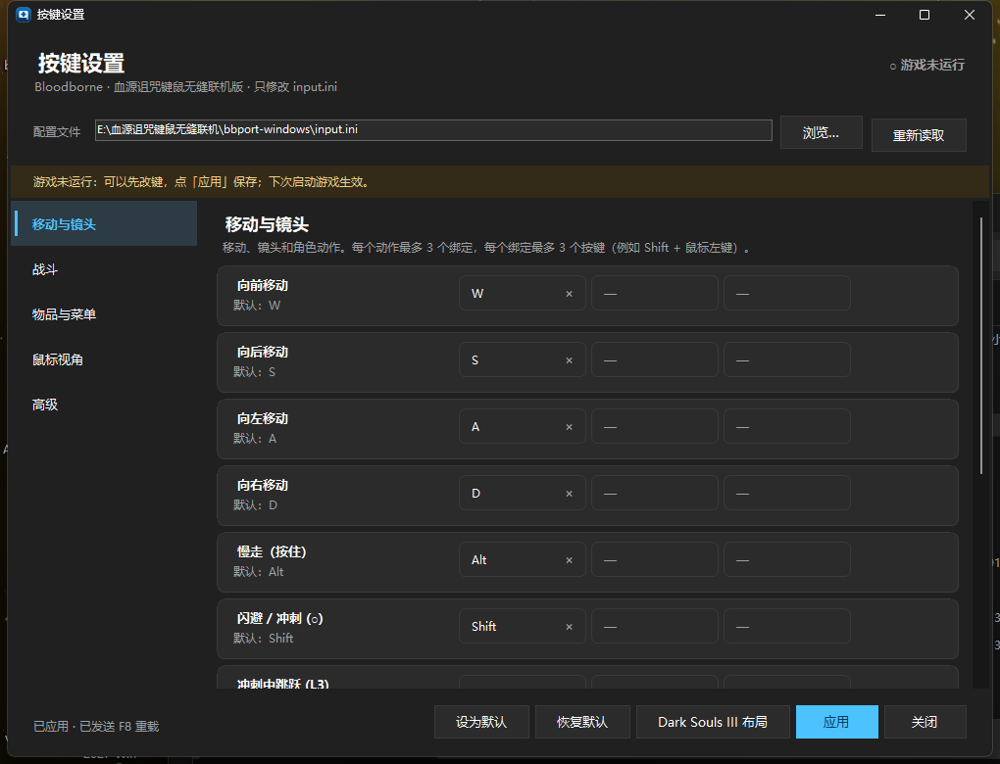
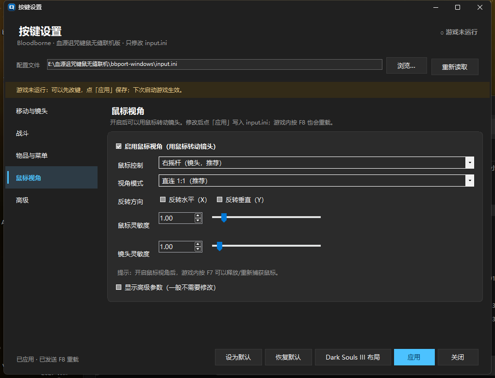

# BB Keybinds

**In-game keyboard & mouse rebinding for Bloodborne on the Windows bbport (shadPS4-based) port.**

A small, standalone Windows tray application that opens an overlay inside the game
(press **F10**), lets you remap every keyboard/mouse binding, and writes the result back to
`input.ini` — then reloads it in-game with **F8**. No game files, emulator binaries, saves,
mods or co-op configuration are touched.



> **Unofficial community tool.** Not affiliated with FromSoftware, Sony Interactive
> Entertainment, or the bbport author. You need your own copy of Bloodborne and bbport.

---

## Download

| | |
|---|---|
| **Latest release** | [github.com/Swn555666/bloodborne-bbport-keybinds/releases/latest](https://github.com/Swn555666/bloodborne-bbport-keybinds/releases/latest) |
| **Direct EXE** | [BBKeybinds.exe](https://github.com/Swn555666/bloodborne-bbport-keybinds/releases/latest/download/BBKeybinds.exe) |
| **Source** | [github.com/Swn555666/bloodborne-bbport-keybinds](https://github.com/Swn555666/bloodborne-bbport-keybinds) |

The release is a self-contained single-file Windows executable. No .NET installation is
required.

---

## Features

- **In-game overlay** — press **F10** (configurable) while playing; the panel appears over
  the game and returns focus when you close it.
- **Full keyboard + mouse rebinding** — keyboard keys, mouse buttons, mouse wheel, and
  combinations such as `Shift + Left click`, up to three bindings per action and three keys
  per binding.
- **Windows-native interaction** — click a slot, press a key, `Esc` to cancel, `×` to clear,
  right-click for "clear / manual entry / restore this action".
- **Conflict detection** — duplicate or overlapping bindings are highlighted in red (warnings
  only; nothing is blocked).
- **Mouse look** — enable mouse camera, choose stick emulation or a direct 1:1 camera,
  adjust sensitivity, invert X/Y, and tune dead zone/speed parameters.
- **Safe writes** — every apply creates `input.ini.bak-YYYYMMDD-HHMMSS` (last 10 kept);
  controller bindings, comments, and unknown settings are preserved byte-for-byte.
- **Instant reload** — after applying, the tool focuses the game and sends the reload key
  (**F8** by default).
- **User defaults** — save your tuned layout with **Set as default**; **Restore defaults**
  then uses *your* layout instead of the factory one.
- **Multiple installations** — if several bbport copies exist, the tool follows the running
  `bb-probe.exe` and can switch to it with **Advanced → Detect game window**.
- **Bilingual-friendly UI** — the interface is Chinese; key names are shown as they appear
  on the keyboard (`Space`, `Shift`, `Left click`, …).

---

## Requirements

| | |
|---|---|
| OS | Windows 10 1903+ or Windows 11, 64-bit |
| Game | Bloodborne CUSA03173, version 1.09 |
| Port | Supermedo **bbport for Windows 1.7.2** (shadPS4-based) |
| Runtime | None — the release is a self-contained single-file executable |
| Build | .NET 8 SDK (only if you build from source) |

> The tool only edits `<bbport>\input.ini`. It does **not** inject into the game, read game
> memory, or modify `bb-probe.exe`, `Bloodborne.exe`, `bbport.ini`, saves, mods, or BBSC
> co-op files.

---

## Installation

1. Download [`BBKeybinds.exe`](https://github.com/Swn555666/bloodborne-bbport-keybinds/releases/latest/download/BBKeybinds.exe)
   (or the zip from the [latest release](https://github.com/Swn555666/bloodborne-bbport-keybinds/releases/latest)).
2. Put it anywhere. The recommended place is a new folder next to your port, for example:

   ```
   Bloodborne\
     bbport-windows\        <- your bbport installation (contains Bloodborne.exe)
     BB Keybinds\
       BBKeybinds.exe
   ```

3. Run `BBKeybinds.exe`. It starts in the system tray.
4. Start the game normally (`PLAY BBPORT + BBSC.cmd`, `Play Bloodborne.exe`, or the launcher).
5. In game, press **F10**.

The first time, the tool auto-detects `input.ini` in this order:

1. the running `bb-probe.exe` directory (most accurate when several copies exist);
2. the last used path;
3. `BB_INPUT_CONFIG` if set;
4. `input.ini` next to the tool, then `..\bbport-windows\input.ini`, then sibling
   `bbport-windows` folders.

If it cannot find the file, click **Browse…** and select your `input.ini`.

---

## Quick start

1. Launch the tool → it sits in the tray.
2. Launch the game.
3. Press **F10** → the settings panel opens over the game.
4. Click a binding slot and press the key or mouse button you want:
   - single key: `K`
   - combination: hold `Shift` / `Ctrl` / `Alt`, then press the main key or click a mouse
     button, e.g. `Shift + Left click`
   - up to three keys per binding
   - `Esc` cancels; the small `×` clears the slot
5. Click **Apply** (or press `Ctrl+S`). The tool:
   - backs up `input.ini`,
   - rewrites only keyboard/mouse bindings and mouse settings,
   - returns to the game and sends **F8** so the game reloads immediately.
6. If the status says it could not focus the game, return to the game and press **F8** once.

> **The game does not pause.** Open the panel in a safe place (a lantern, the Hunter's
> Dream, or a quiet corner).

---

## Using the overlay

| Element | Meaning |
|---|---|
| Left navigation | Movement & camera / Combat / Items & menus / Mouse look / Advanced |
| Action row | One game action, its PlayStation button hint, and up to **3** binding slots |
| Slot | Click to capture; `×` clears; right-click for more |
| `—` | Empty slot |
| Red slot | This binding collides with another action (warning only) |
| `Apply *` | There are unsaved changes |

### Binding capture

- The slot shows **“Press a key…”** while capturing.
- Keyboard combinations are built from modifiers held at the time of the main key.
- Mouse buttons (`Left`, `Right`, `Middle`, `Back`, `Forward`) and the wheel are supported.
- **Modifier-only** bindings are allowed (e.g. bind a single `Shift`).
- `Esc` cancels. To bind `Esc` itself, use **right-click → Manual entry…**.
- Reserved keys are rejected with a message: `Insert` (the port's settings menu), `F9`
  (pad recording), the mouse-look toggle (`F7`), the reload key (`F8`), and the panel's own
  hotkey (`F10` by default).
- Stick direction outputs (`Move forward`, `Camera left`, …) accept **keyboard keys only** —
  a mouse button is a press, not an axis.

### Conflict warnings

A red slot means the same combination (or a modifier overlap, e.g. one action on `Shift`
and another on `Shift + Left click`) is used by another action. This mirrors the bbport
launcher's Controls page: it is a warning, not a hard error. Intentional overlaps such as
“left click attacks and confirms menus” are allowed.

### Manual entry

Right-click a slot → **Manual entry…** and type the file syntax directly:

```
space
lshift, leftbutton
mousewheelup
```

This is the escape hatch for keys that are hard to capture (`escape`, `insert` is still
reserved).

---

## Mouse look



Open **Mouse look** in the left navigation:

- **Enable mouse look** → `mouse_to_joystick = right` (or left).
- **Stick** mode (`mouse_camera = stick`) emulates the right stick: smooth, but limited by
  the game's own turn speed and acceleration.
- **Direct 1:1** (`mouse_camera = direct`) writes the game camera yaw/pitch directly — a
  native-PC feel. It requires the Bloodborne 1.09 camera hook and works with a locked frame
  rate (60 FPS is a good choice).
- Sensitivity, invert X/Y, and the advanced dead-zone/speed parameters are written to
  `input.ini`.
- **F7** toggles mouse look/capture at runtime.
- Mouse buttons and the wheel only act **while the mouse is captured**: the game window is
  focused, the port's settings menu and text entry are closed, and mouse look is on.

---

## Applying, backups and reloading

**Apply** (or `Ctrl+S`):

1. validates every binding;
2. if `input.ini` changed on disk since it was loaded, asks whether to reload, overwrite, or
   cancel;
3. backs up the file to `input.ini.bak-YYYYMMDD-HHMMSS` (last 10 kept);
4. rewrites only keyboard/mouse bindings and mouse settings;
5. writes UTF-8 without BOM, LF line endings;
6. if the game is running, hides the panel, focuses `bb-probe.exe`, and sends the reload key
   (**F8** by default).

Controller lines, comments and unknown keys are preserved. The same output format is used by
the bbport launcher's **Controls** page, so both can be mixed freely.

> **Line reordering is normal.** When multiple bindings exist for one action, the file writer
> groups them at the first occurrence of that output. For example `r1 = leftbutton` from the
> Mouse section may move next to `r1 = 3` in the Keyboard section. Gameplay is unaffected.

---

## Default layouts and profiles

- **Restore defaults** loads the factory bbport keyboard/mouse layout into the editor.
- **Set as default** saves the current editor state as *your* default in
  `%APPDATA%\BB Keybinds\default-layout.ini`. From then on **Restore defaults** uses your
  layout. This is how you keep a personal Elden Ring-style or DS3-style scheme.
- **Advanced → Clear custom default** deletes that file and returns to the factory layout.
- **Dark Souls III layout** loads a complete keyboard + mouse scheme into the editor
  (mouse look on, left click attack, right click strong attack, side buttons weapon/firearm).

Saving a layout never writes it to `input.ini` immediately: it only changes what
**Restore defaults** loads. Click **Apply** to write it.

---

## Tray icon and shortcuts

| Shortcut | Action |
|---|---|
| **F10** (configurable) | Open/close the panel (global hotkey, works over the game) |
| **F7** | bbport: toggle mouse look / mouse capture |
| **F8** | bbport: reload `input.ini` |
| **Ctrl+S** | Apply |
| **Esc** | Close the panel |
| **F1** | Open `input.ini` |
| **Insert** | bbport's own settings menu — see troubleshooting |

Tray menu: **Open settings**, **Open input.ini**, **Open containing folder**,
**Detect game window**, **Exit**. Closing the window (`×`) only hides it to the tray.

You can change the panel hotkey in **Advanced → Panel hotkey**. If another program already
owns it, choose another key or combination.

---

## Troubleshooting

### The keyboard/mouse does nothing at all in game

**Most common cause: the port's own settings menu or text entry is open.** bbport deliberately
sends *neutral* pad input while its overlay captures input. Press **Insert** (or `L3+R3` on a
controller) until the `Bloodborne - Settings` window is **closed**. If a text box is open,
press `Esc`. Then click the game window and try again.

### The game is focused but movement keys do nothing

- Click the game window once; make sure no terminal, launcher or overlay is in front.
- Press `Alt+Tab` and select **Bloodborne™**.
- Check that `input.ini` is the file of the running installation: **Advanced → Detect game
  window** follows the running `bb-probe.exe`.
- Try the factory layout (**Restore defaults → Apply**) to rule out a custom binding.

### The mouse turns nothing

- Enable **Mouse look** and apply.
- Press **F7** once; the mouse must be captured (the cursor is hidden).
- The game window must be focused, and the port's settings menu/text entry closed.
- Mouse **buttons** do not fire while the mouse is not captured.

### Left click does not confirm menus

Bind `cross = leftbutton` (Cross is the confirm button) and keep mouse look enabled. The
tool warns that `cross` and `r1` share the left button — this is intentional, the same way
Elden Ring uses left click for both attacks and menu confirmation. In gameplay, left click
will also interact with nearby items.

### The panel is not visible in fullscreen

bbport's fullscreen may be exclusive on some systems. Press `Alt+Tab` to reach the panel, or
use a borderless/windowed mode in the bbport launcher. The tool never changes your display
settings automatically.

### A controller is connected

Keyboard and controller bindings are combined in bbport 1.7.2, not a fallback. If you want to
isolate keyboard/mouse behavior, unplug the controller and restart the game.

### Chinese IME / non-US keyboard layouts

bbport names keys by what the key shows on the active layout. Use an English/IME-off state
while testing. If the port's overlay text entry is active, game input is blocked.

---

## How it works

bbport reads `input.ini` next to `bbport.ini` (`BB_INPUT_CONFIG` overrides the path). The file
is shadPS4's input-config syntax:

```ini
# output = input
cross = space
circle = lshift
r1 = 3
r1 = leftbutton
axis_left_y_minus = w
axis_left_y_plus = s
mouse_to_joystick = right
mouse_camera = direct
```

This tool implements the same parser/writer rules as bbport's launcher
(`bbport_input_config`): whitespace-insensitive lines, comment handling, up to 3 slots per
action in the UI, up to 3 keys per binding, keyboard-only stick half-axes, and preservation of
controller/comment lines. It never edits `bbport.ini` or any other file.

See [`examples/`](examples/) for complete layouts.

---

## Building from source

```bat
cd src
dotnet build -c Release
```

Self-contained single-file executable:

```bat
dotnet publish -c Release
```

The output is `src\bin\Release\net8.0-windows\win-x64\publish\BBKeybinds.exe` (about 64 MB,
no .NET installation required on the target machine).

Requirements: .NET 8 SDK on Windows. The project targets `net8.0-windows` and uses
WinForms, P/Invoke only — no third-party packages.

---

## Self-test

The executable contains a headless test suite for the `input.ini` format:

```bat
BBKeybinds.exe --selftest report.txt
```

It checks parsing, round-trip preservation of controller/comment lines, combinations,
conflicts, slot indexing, default/DS3 layouts, UTF-8/no-BOM writing, and mouse settings.
The exit code is `0` when all checks pass.

---

## Examples

| File | Description |
|---|---|
| [`examples/factory-default.ini`](examples/factory-default.ini) | bbport's factory keyboard + mouse layout |
| [`examples/dark-souls-3.ini`](examples/dark-souls-3.ini) | Dark Souls III-style keyboard + mouse layout |
| [`examples/elden-ring-style.ini`](examples/elden-ring-style.ini) | Elden Ring-style example: E/Left click confirm, ESC menu, direct mouse camera, L3 on Z |

To try an example, copy it over your port's `input.ini` (a backup is recommended) and press
**F8** in game. Or load it into the tool by copying it to
`%APPDATA%\BB Keybinds\default-layout.ini` and choosing **Restore defaults**.

---

## Compatibility and scope

- Designed for **bbport Windows 1.7.2** and Bloodborne **CUSA03173 1.09**.
- The `input.ini` format is shadPS4's; a shadPS4 `CUSA03173.ini` can be copied over it.
- The tool does not modify the game, emulator, co-op (BBSC), saves, or mods. It has no
  anti-cheat implications and performs no process injection or memory access.
- Mouse camera `direct` depends on the port's game-1.09 camera hook; if unavailable, bbport
  falls back to stick emulation and logs it.

---

## Authors

- **Swn555666** — project owner, key-layout design, testing and documentation.
  [github.com/Swn555666](https://github.com/Swn555666)
- **Claude (Anthropic)** — implementation and documentation assistance, built with
  [Claude Code](https://claude.ai/code).

This project was built collaboratively: the key layout and requirements come from
Swn555666; the Windows application and the `input.ini` compatibility layer were implemented
with Claude.

## Credits

- **bbport / bloodborne_pc** by Supermedo — the Windows port this tool is written for
  (GPL-2.0). <https://github.com/Supermedo/bloodborne_pc>
- **shadPS4** — input-config syntax and emulator foundations.
- **deadinside28/bloodborne_pc** — the Linux port bbport is built on.
- The bbport launcher's `bbport_input_config` module and `docs/INPUT.md` defined the exact
  file semantics implemented here.

See [`NOTICE.md`](NOTICE.md) for details.

## License

GNU General Public License v2.0 or later (`GPL-2.0-or-later`). See [`LICENSE`](LICENSE).
